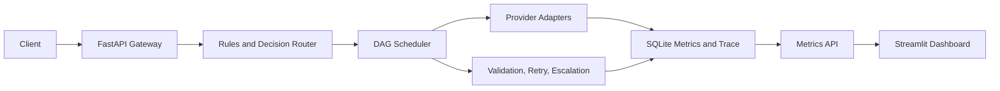

# Enterprise AI Intelligence & ROI Platform

## Build plan

1. Establish the Python package, validated settings, shared schemas, and health API.
2. Add provider adapters and YAML model registry.
3. Implement deterministic rules, bounded decisions, complexity scoring, routing strategies, and precision policy.
4. Add isolated node context, concurrent DAG execution, and critical path tracing.
5. Validate task outputs and apply request-wide retry and escalation budgets.
6. Persist metrics and expose aggregations and baseline ROI.
7. Add privacy-aware edge routing and offline harness optimization.
8. Connect the API request lifecycle and demo seed workflow.
9. Build the Plotly Streamlit metrics dashboard.
10. Document operations, package Docker and Make targets, and run final checks.

## Architecture

The implementation is mock-first: the demo runs without external credentials. Real provider adapters are optional and configured through environment variables.
